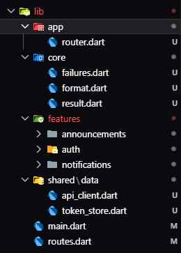
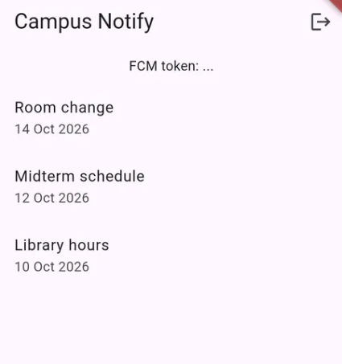
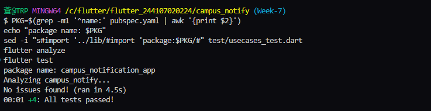
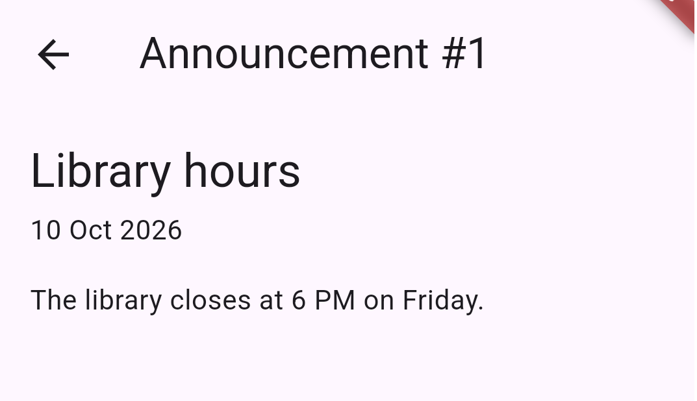
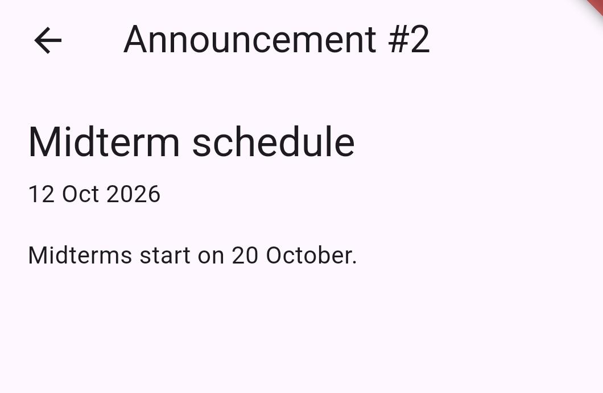
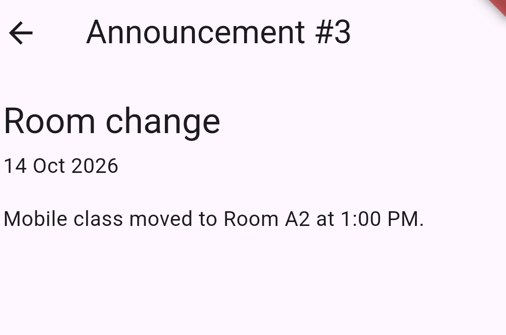

# Lab 1 

# Lab 2

# Lab 3

# Assignment

# Reflection 

## 1. Why must the repository interface live in domain, not in data? What breaks if it is reversed?
The domain says what it needs, and the data layer provides it. If the interface lived in `data`, the domain would import the data layer and depend on Dio or storage. Use cases then can't be tested without them, and swapping a data source forces changes in the domain.

## 2. When is a use case truly needed, and when is repository straight to notifier enough?
A use case is needed when there is a business rule or several sources are combined, like `LoginUser` (validation) and `GetAnnouncements` (sorting). For simple one-line calls like `fetchById` or `logout`, the provider can call the repository directly.

## 3. What does over-engineering cost a small team? When is the cost worth it?
Each extra class is more code to write, read, and test, and it only forwards a call. It is worth it when the app is big, several people work on it, rules will grow, or the same operation is reused in many places.

## 4. Which part of the AI proposal did you reject or simplify, and why?
- I kept use cases only where there is real logic, not for every method.
- I deleted `app_deps.dart` because Riverpod already does the wiring.
- I removed duplicate files (`home_pages`, `login_pages`, `fcm_service`) that made imports confusing.
- I kept the announcements source mocked because there is no backend yet.