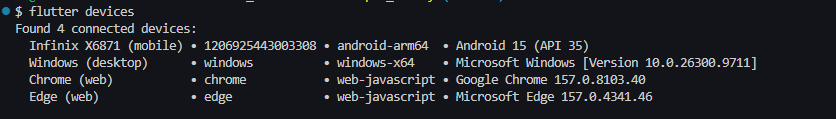
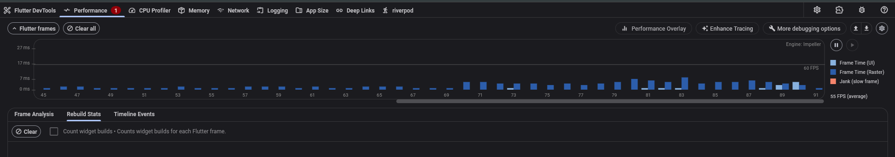
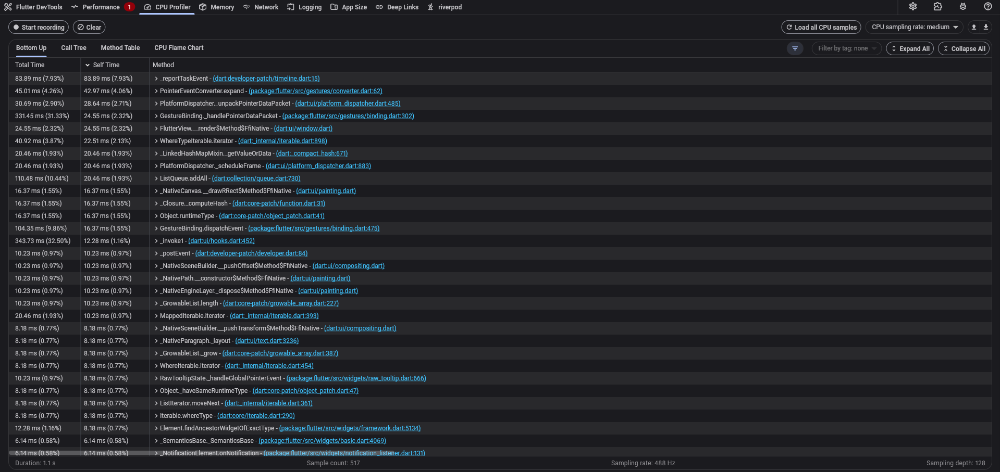
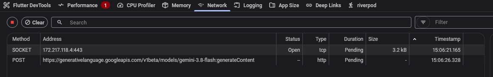
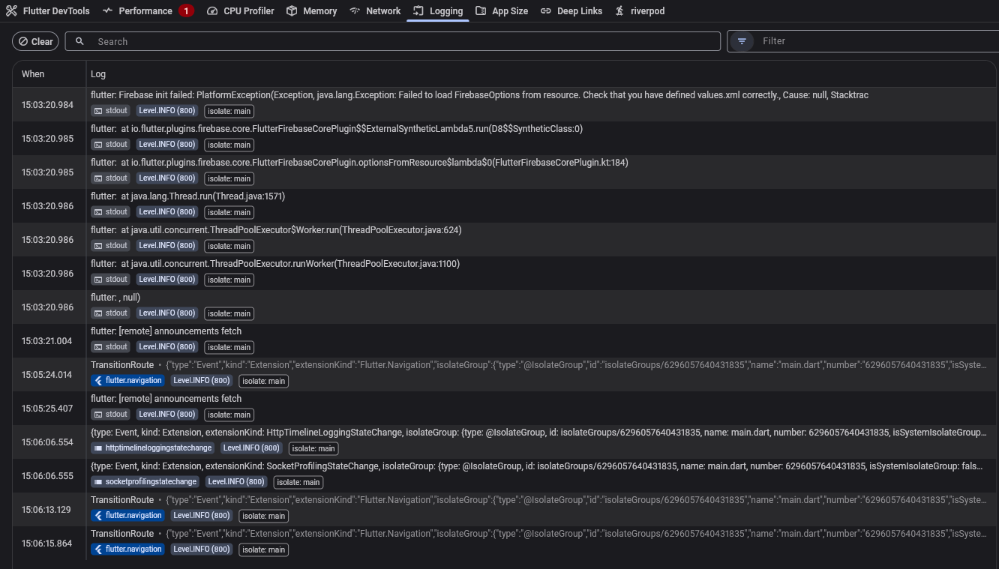
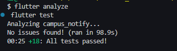

# Flutter Device 

# Performance

## Memory Usage

## Network Usage

# Logging

# Assignment

# Reflection 

## 1. Which optimization had the biggest impact and why?
The repository cache. Before, opening each detail page fetched the whole announcement list again, so my test (home, detail 1, detail 2) made 3 remote calls. After the cache it made 1. Extracting the widgets also stopped the home page from rebuilding while typing, but with only 3 list items I could not see that in frame time, only in rebuild counts.

## 2. How did you verify optimizations actually work (not placebo)?
I ran the same steps on the same phone in profile mode before and after, and compared the `[remote]` log lines and the rebuild counts in DevTools. I also wrote tests for the cache (call counts, expiry, stale data on error) and a widget test to check that search still filters the list the same way.

## 3. What trade-offs did you face (for example, code complexity vs performance)?
The cache adds state and a time limit to the repository, and the extracted widgets mean more small files. The data can also be up to 30 seconds old. I kept the limit short and only use old data when a refresh fails.

## 4. When should premature optimization be avoided?
When nothing shows a problem yet. My list only has 3 mock items, so frame times were already fine. I only changed what the logs and DevTools showed (extra fetches and rebuilds), and I did not add pagination or image caching because I had no case that needed them.