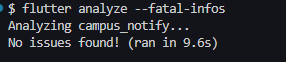
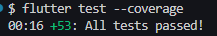

# Assignment



## flutter-ci.yml

```yaml
name: Flutter CI

on:
  push:
    branches: [main]
  pull_request:
    branches: [main]
  workflow_dispatch:

permissions:
  contents: read

concurrency:
  group: ${{ github.workflow }}-${{ github.ref }}
  cancel-in-progress: true

jobs:
  test-and-build:
    runs-on: ubuntu-latest
    defaults:
      run:
        working-directory: campus_notify
    steps:
      - uses: actions/checkout@v4
      - uses: subosito/flutter-action@v2
        with:
          channel: stable
      - run: flutter pub get
      - run: dart format --output=none --set-exit-if-changed .
      - run: flutter analyze --fatal-infos
      - run: flutter test --coverage
      - run: flutter build apk --release
      - run: flutter build appbundle --release
      - uses: actions/upload-artifact@v4
        with:
          name: campus-notify-android-builds
          path: |
            campus_notify/build/app/outputs/flutter-apk/app-release.apk
            campus_notify/build/app/outputs/bundle/release/app-release.aab
          if-no-files-found: error
          retention-days: 7
```
# Reflection - Week 13 : CI/CD and Automation

## 1. What problem was detected automatically before changes were merged?
The workflow checks formatting, static analysis and tests on every pull request, so problems are caught before they reach `main`. 

## 2. What information would help you investigate a failed build?
The most useful information is the name of the failing step and its log output, because it shows whether the problem is formatting, analysis, a test or the Android build.

## 3. What still needs approval or manual review before a release?
The APK are built in release mode but are not signed with a production keystore, so they cannot be published to the Play Store yet. The app still needs a review from the tester and need to have permissions such as notifications, and a check that the Gemini API key is not exposed, because a value compiled into the app can be extracted from the APK. The `integration_test` also does not run in this workflow, so login, search and the detail page still need a manual check on a device.
