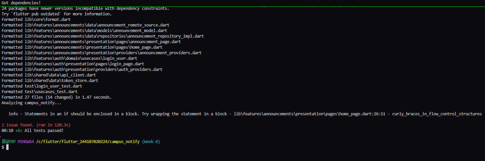
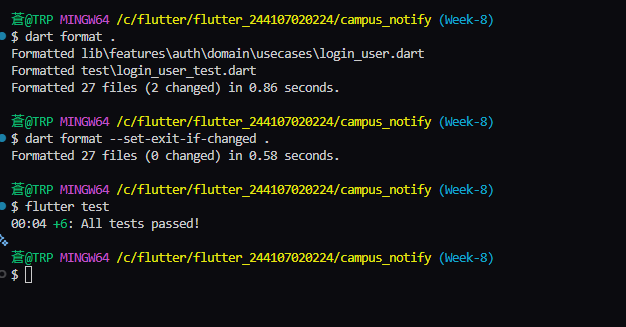
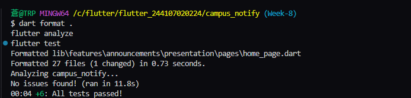

# Lab 1 


# Lab 2


# Lab 3


# AI Review (raw output) - Week 8

**PR:** feat(auth): trim and lowercase email before login + tests

**Prompt:**
```
Review this Flutter PR as a senior Flutter dev.
Context: feature-first Clean Architecture
(presentation -> domain <- data),
Riverpod, GoRouter, SQLite + Dio.
Focus: correctness, architecture, tests. Ignore style.
Give the top 5 findings + severity (blocker/suggestion)
+ rationale + proposed code fix.
```

**Summary:** No blockers. The dependency rule holds: `LoginUser` imports only `core` and `domain`.

## 1. Weak email validation lets bad input through (suggestion)
**Where:** `login_user.dart`, `cleanEmail.contains('@')`.
**Rationale:** `@`, `a@` and `@b` all pass validation and reach the repository. The normalization makes it look validated, but the rule is still very loose.
**Fix:**
```dart
static final _emailRe = RegExp(r'^[^@\s]+@[^@\s]+\.[^@\s]+$');

if (!_emailRe.hasMatch(cleanEmail)) {
  return const Err(ValidationFailure('Enter a valid email'));
}
```

## 2. Test gap: password and invalid-format paths are untested (suggestion)
**Where:** `login_user_test.dart` covers trim and blank email only.
**Rationale:** The short-password branch and the "no @" branch have no test, so a rule change would pass CI unnoticed.
**Fix:**
```dart
test('short password is rejected and the repository is not called', () async {
  final repo = CapturingAuthRepo();
  final r = await LoginUser(repo).call('a@b.com', '123');
  expect(r, isA<Err<AuthSession>>());
  expect(repo.lastEmail, isNull);
});

test('email without a domain is rejected', () async {
  final repo = CapturingAuthRepo();
  final r = await LoginUser(repo).call('alif@', '123456');
  expect(r, isA<Err<AuthSession>>());
});
```

## 3. `AuthRepositoryImpl.login` turns every error into `AuthFailure` (suggestion)
**Where:** `auth_repository_impl.dart`, `catch (e) => Err(AuthFailure(...))`.
**Rationale:** A storage error or a network error is reported as "wrong email or password".

# Assignment

import 'package:flutter_test/flutter_test.dart';
import 'package:campus_notification_app/core/failures.dart';
import 'package:campus_notification_app/core/result.dart';
import 'package:campus_notification_app/features/auth/domain/entities/auth_session.dart';
import 'package:campus_notification_app/features/auth/domain/repositories/auth_repository.dart';
import 'package:campus_notification_app/features/auth/domain/usecases/login_user.dart';

class CapturingAuthRepo implements AuthRepository {
  String? lastEmail;

  @override
  Future<Result<AuthSession>> login(String email, String password) async {
    lastEmail = email;
    return Ok(AuthSession(email: email));
  }

  @override
  Future<bool> hasSession() async => false;

  @override
  Future<void> logout() async {}
}

void main() {
  test('trims and lowercases the email before calling the repository',
      () async {
    final repo = CapturingAuthRepo();
    final r = await LoginUser(repo).call('  Alif@Mail.COM ', '123456');
    expect(r, isA<Ok<AuthSession>>());
    expect(repo.lastEmail, 'alif@mail.com');
  });

  test('blank email is rejected and the repository is not called', () async {
    final repo = CapturingAuthRepo();
    final r = await LoginUser(repo).call('   ', '123456');
    expect(r, isA<Err<AuthSession>>());
    expect((r as Err<AuthSession>).failure, isA<ValidationFailure>());
    expect(repo.lastEmail, isNull);
  });

  test('email without a domain is rejected', () async {
    final repo = CapturingAuthRepo();
    final r = await LoginUser(repo).call('alif@', '123456');
    expect(r, isA<Err<AuthSession>>());
    expect(repo.lastEmail, isNull);
  });

  test('short password is rejected and the repository is not called',
      () async {
    final repo = CapturingAuthRepo();
    final r = await LoginUser(repo).call('a@b.com', '123');
    expect(r, isA<Err<AuthSession>>());
    expect(repo.lastEmail, isNull);
  });
}

