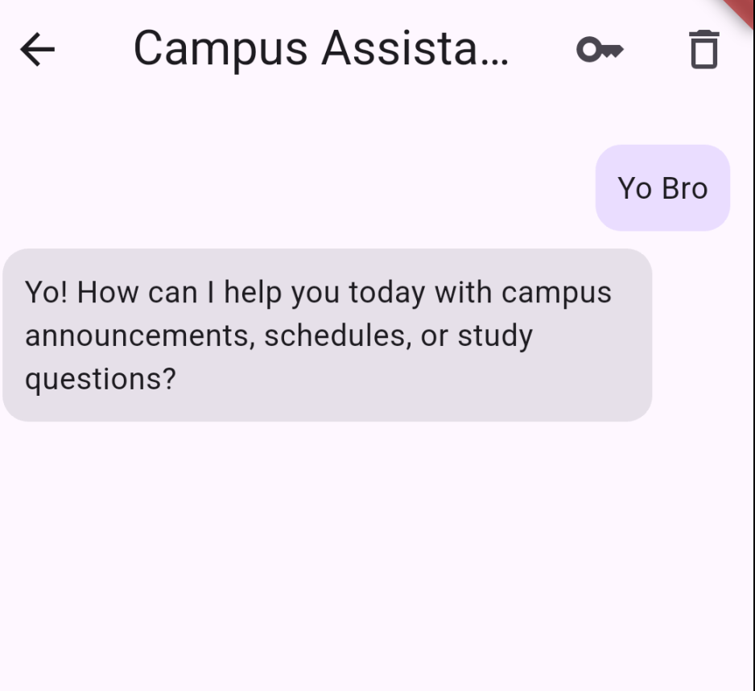
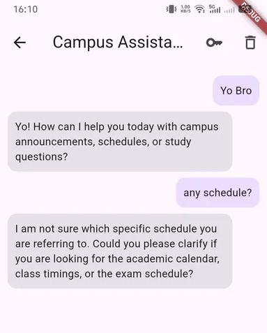

# Assignment

## Asking Schedule 

# Reflection - Week 10: AI Feature Integration

## 1. Which AI feature did you integrate and why?
I integrated a chat assistant for campus questions. Students already read announcements in the app, and a short Q&A is the fastest way to find a date or a rule. It calls the Gemini API through a clean-architecture slice (use case in domain, remote source and repository in data, provider and page in presentation).

## 2. How do you protect user privacy when using AI API?
- I send only the typed question and earlier chat turns, with no profile data.
- A domain use case redacts emails and long numbers (phone, ID) before anything leaves the app.
- The system prompt tells the model never to ask for or repeat personal data.
- The API key is kept in secure storage and sent in a header, not in the URL or the source code.
- The AI client uses its own Dio, so the campus login token is never sent to the AI provider.

## 3. What fallback do you provide if AI service errors?
Each failure shows a clear message, no key, key rejected, too many requests, service busy, or unexpected response. The user can retry, or use the announcement list, which does not depend on the AI. A timeout stops the request, so the app never waits forever.

## 4. One thing you learned about AI feature UX on mobile?
A visible loading state and a clear error message matter more than a clever answer. The call can take several seconds or fail on a weak connection, so the user must always know whether the app is thinking, failed, or can be retried.