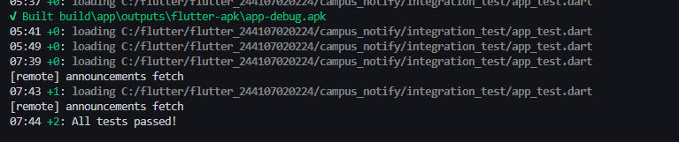
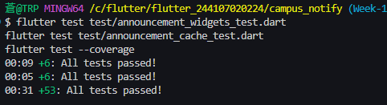
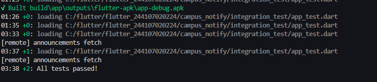

# Feature tested
Login and announcements (list, search, detail), plus the token refresh and the assistant error handling behind them.

# Assignment 

# Reflection - Week 12: Testing and Quality Assurance

## 1. Which bug would have been easiest to miss without the tests you wrote?
The token refresh retry. When a request returns 401 the app refreshes and retries once, and nothing in normal use shows what happens if the retry also fails. `api_client_test.dart` covers that case with a scripted adapter, and when I removed the `retried` check on purpose the test failed. <replace with your own result if it differed>

## 2. Where did you need a fake, and how did it make the test more consistent?
I used fakes for the secure token storage, the Dio adapter, the Gemini source and the repositories. The fake Dio adapter lets me script the exact status codes (401, then 200) without a network, and the fake token store avoids touching the phone's secure storage, so the tests run the same way every time.

## 3. What did the widget and integration tests each tell you about your feature?
The widget tests showed that single screens behave correctly in each state: invalid input feedback, loading, error with Retry, empty results. The integration test showed that login, routing, search and the detail page work together on a real device, which the widget tests cannot show. <add anything you noticed while running it on the phone>
